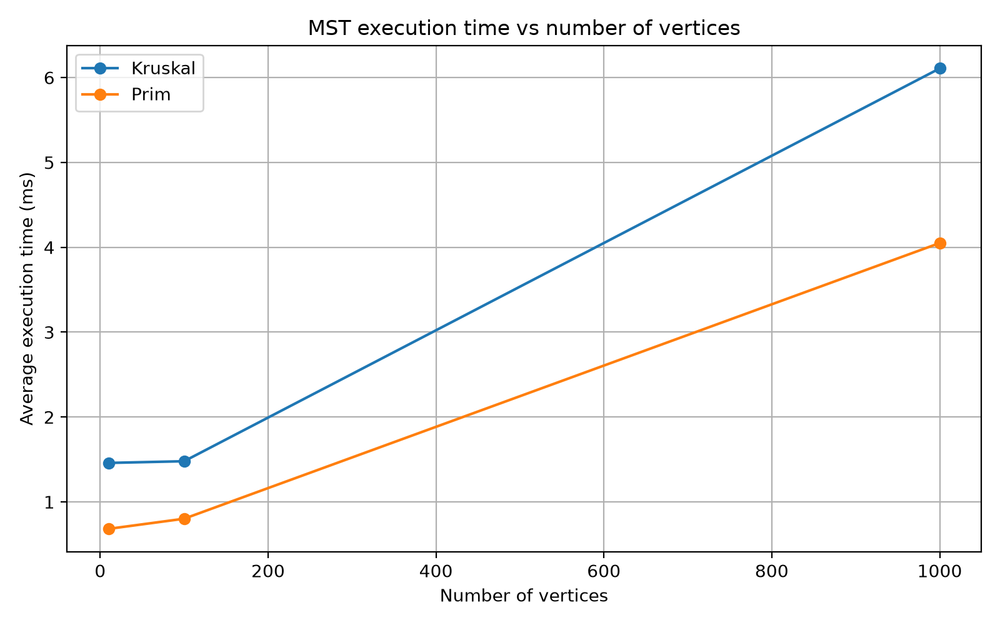
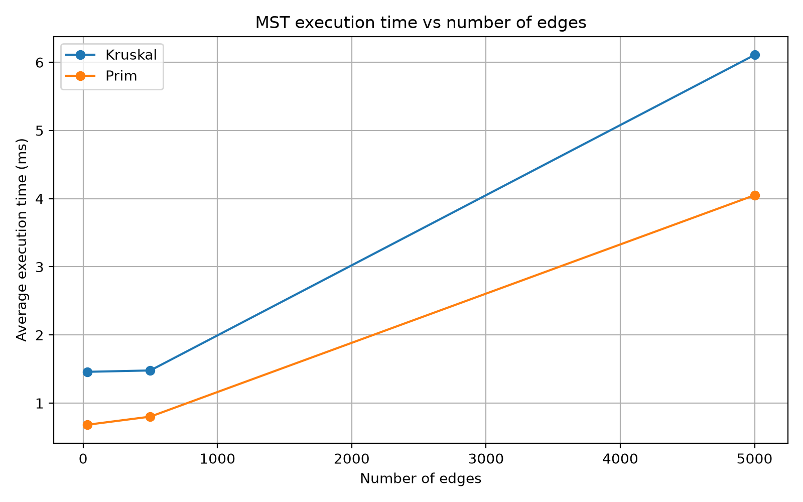
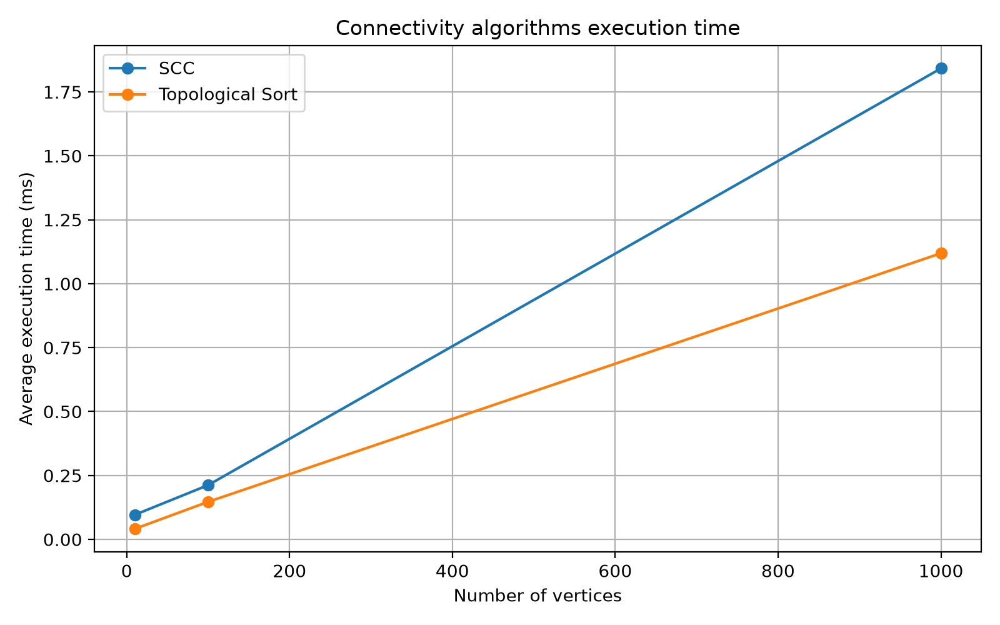

# Assignment 3 — Smart City Infrastructure and Route Planning

## 1. Overview

This project models a smart city's infrastructure as a graph.

Vertices represent city districts or locations, while edges represent roads or infrastructure connections. Edge weights represent construction costs or travel distances.

The project implements algorithms for:

1.Minimum Spanning Tree;
2.connectivity analysis;
3.strongly connected components;
4.topological ordering;
5.shortest paths.

The implemented algorithms are:

1.Disjoint Set Union (DSU);
2.Kruskal's algorithm;
3.Prim's algorithm; 
4.Kosaraju's algorithm for SCC;
5.Kahn's algorithm for topological ordering;
6.Dijkstra's algorithm.

## 2. Implementation

### Graph representation

The graph is represented using adjacency lists.

Each edge stores:

-source vertex;
-destination vertex;
-weight.

The graph supports both directed and undirected edges.

### DSU

The Disjoint Set Union structure uses:

- path compression;
- union by rank.

These optimizations reduce the cost of repeated find and union operations.

### Kruskal

Kruskal's algorithm sorts the edges by weight and uses DSU to determine whether adding an edge would create a cycle.

The algorithm stops after V - 1 edges have been selected.

### Prim

Prim's algorithm starts from one vertex and repeatedly selects the minimum-weight edge connecting the current tree to an unvisited vertex.

A priority queue is used to select the next edge.

### SCC

Strongly Connected Components are found using Kosaraju's algorithm.

The algorithm performs:

1.DFS to determine finishing order.
2.Construction of the transposed graph.
3.DFS on the transposed graph in reverse finishing order.

### Topological Sort

Topological ordering is implemented using Kahn's algorithm.

The algorithm uses vertex indegrees and a queue of vertices with indegree zero.

If not all vertices can be processed, the graph contains a cycle.

### Dijkstra

Dijkstra's algorithm calculates shortest paths from a selected source vertex.

A priority queue is used to process the vertex with the smallest current distance.

Only non-negative edge weights are supported.

## 3. Complexity Analysis

1)DSU: O(α(V)) amortized per operation; O(V) 

2)Kruskal: O(E log E) ; O(V + E) 

3)Prim: O(E log V) with binary heap; O(V + E) 

4)SCC: O(V + E); O(V + E) 

5)Topological Sort: O(V + E); O(V + E) 

6)Dijkstra:  O((V + E) log V) with binary heap;  O(V + E) 

### DSU

Path compression makes the trees flatter after find operations.

Union by rank prevents the trees from becoming unnecessarily tall.

Together, these optimizations make DSU operations almost constant time in practice.

### Kruskal

The dominant operation is sorting the edges.

Therefore, the running time is:

O(E log E).

### Prim

Using an adjacency list and binary heap, Prim's algorithm runs in:

O(E log V).

### SCC

Kosaraju's algorithm processes every vertex and edge a constant number of times:

O(V + E).

### Topological Sort

Each vertex and directed edge is processed once:

O(V + E).

### Dijkstra

With an adjacency list and binary heap:

O((V + E) log V).

Dijkstra is unsuitable for negative edge weights because a vertex considered finalized can later receive a shorter path through a negative edge.

## 4. Experimental Setup

The experiments use reproducible graphs generated with fixed random seeds.

The following graph sizes are used:

Graph:
1.Small V=10 E=30 
2.Medium V=100 E=500 
3.Large V=1000 E=5000 

Each experiment is repeated five times.

Execution time is measured using System.nanoTime().

The average execution time is reported in milliseconds.

For MST experiments, generated undirected graphs are connected.

For connectivity experiments, directed graphs are generated using a fixed random seed. DAGs are generated so that edges go from lower-numbered vertices to higher-numbered vertices, preventing cycles.

## 5. Results

### MST

Kruskal and Prim were tested on graphs with increasing numbers of vertices and edges.

The measured results are stored in:

results/mst_benchmark.csv

The results show how execution time changes as the graph becomes larger.

### Connectivity

SCC and topological sorting were tested on directed graphs and DAGs.

The measured results are stored in:

results/connectivity_benchmark.csv

A cyclic graph was also tested to verify that topological sorting correctly rejects graphs containing cycles.

### Dijkstra

Dijkstra was tested on graphs of different sizes.

The results are stored in the corresponding benchmark CSV file.

## 6. Plots

### Execution time vs number of vertices

### Execution time vs number of edges

### Connectivity algorithms

---

## 7. Comparison and Discussion

Kruskal and Prim both produce a minimum spanning tree with the same total weight for a connected undirected weighted graph.

Kruskal is based on sorting edges and DSU operations, while Prim grows the MST from a starting vertex using a priority queue.

For sparse graphs, both algorithms can perform efficiently. The experimental results show how their execution time changes as the number of vertices and edges increases.

SCC and topological sorting have linear theoretical complexity, O(V + E). Therefore, their running time should increase approximately with the size of the graph.

Dijkstra is appropriate for shortest-path problems when all edge weights are non-negative.

The experimental results should be interpreted together with the theoretical complexity because actual execution time is also affected by JVM behaviour, data structures, memory allocation, and system load.

## 8. Testing

The implementation was tested using:

-small graphs;
-disconnected graphs;
-cyclic graphs;
-graphs with multiple valid MSTs;
-graphs with unreachable vertices;
-duplicate edge weights;
-single-vertex graphs.

Correctness checks include:

-Kruskal and Prim return the same MST weight;
-topological ordering is valid for DAGs;
-cyclic graphs are rejected by topological sorting;
-every vertex belongs to exactly one SCC;
-Dijkstra returns correct shortest distances;
-unreachable vertices are handled correctly.

## 9. Conclusion

This project demonstrates several fundamental graph algorithms used for smart-city infrastructure planning and route analysis.

Kruskal and Prim solve the minimum spanning tree problem.

SCC identifies groups of mutually reachable locations in directed networks.

Topological sorting is useful for dependency and scheduling problems where the graph is acyclic.

Dijkstra provides shortest paths when edge weights are non-negative.

The experimental analysis demonstrates how algorithm performance changes as graph size increases and shows the relationship between theoretical complexity and practical execution time.